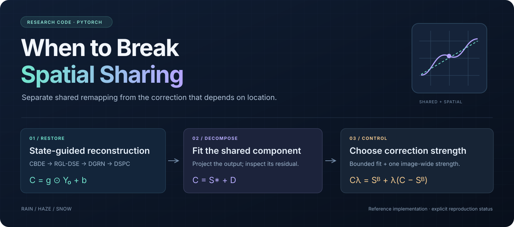
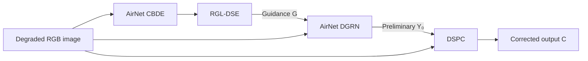

<div align="center">



### Output-Space Decomposition for Unified Adverse Weather Restoration

[](https://github.com/Nopon-Knowledge/spatial-sharing-restoration/actions/workflows/tests.yml)
[](pyproject.toml)
[](pyproject.toml)
[](LICENSE)

**[English](README.md) · [简体中文](README.zh-CN.md)**

[Quick start](#quick-start) · [Method](#method) · [Experiments](#experiments) · [Reproduction status](#reproduction-status) · [Documentation](#documentation)

</div>

## Why spatial sharing?

A spatially varying correction can improve an image, but some of that improvement may be explained by a transformation shared across the entire image. This toolkit separates those effects: fit the shared component of a restored output, measure the remaining correction, and test whether its **location and strength** actually help restoration.

It accompanies the manuscript **“When to Break Spatial Sharing: Output-Space Decomposition for Unified Adverse Weather Restoration.”** The code implements the paper's method and analysis in PyTorch, with explicit dataset manifests and reproducibility checks.

> **Release status:** this is a newly written reference implementation. The equations, modules, and synthetic pipeline have been tested; full WeatherBench training and the paper's benchmark scores have not been reproduced with this release. Pretrained weights and original split manifests are not included.

## At a glance

| Restore | Decompose | Test correction utility |
| :--- | :--- | :--- |
| Residual-supervised global and local states | Shared affine and box-constrained fits | Energy-preserving spatial shifts |
| Bounded, coarse-grid photometric correction | Global color matrix and monotone tone curve | Residual projection and oracle diagnostics |
| Two-stage training and B0–B5 ablations | Exact unclipped RGB error decomposition | Learned strength and paired scene bootstrap |

## Quick start

**Run the CPU checks first.** No dataset, checkpoint, CUDA installation, or AirNet download is needed for the synthetic pipeline.

```bash
git clone https://github.com/Nopon-Knowledge/spatial-sharing-restoration.git
cd spatial-sharing-restoration

python3 -m venv .venv
source .venv/bin/activate
python -m pip install -e '.[test]'

python -m pytest -q
python -m spatial_sharing smoke --output runs/smoke
```

The smoke command exercises training, exact checkpoint resume, evaluation, output decomposition, frozen-base gate training, and inference. Its report is saved to `runs/smoke/smoke_report.json`.

The smoke backbone and generated images are **test fixtures**. The optional upstream encoder test is skipped until AirNet is fetched; CI fetches the pinned revision and runs it.

<details>
<summary><b>Use the method directly in Python</b></summary>

```python
import torch
from spatial_sharing import RGLDSE, DSPC
from spatial_sharing.projection import project_affine

# Shape example with synthetic tensors, not a restored benchmark image.
x = torch.rand(1, 3, 128, 128)
y0 = torch.rand_like(x)
z = torch.randn(1, 256)
features = torch.randn(1, 64, 128, 128)

guidance = RGLDSE()(z, features)["guidance"]
out = DSPC()(x, y0)  # Initially the identity: zero-initialized heads.

shared, gain, offset = project_affine(
    y0[0].numpy(),
    out["corrected"][0].detach().numpy(),
)
```

`DSPC` can wrap another restoration backbone through `DSPC()(x, backbone(x))`. Training recipes and benchmark validation for that backbone remain separate experiments.

</details>

## Method

### 1. Restore with global and local guidance



**RGL-DSE** combines image-wide channel gates with local state maps at scales 1, 2, and 4. Training targets are derived from paired input–reference residuals. The two guidance-injection scalars start at zero.

**DSPC** predicts RGB log-gain and offset fields on a coarse grid. It interpolates the log-gains before exponentiation and applies the fields at full resolution:

$$
C = g \odot Y_0 + b, \qquad g \in [e^{-0.4}, e^{0.4}], \quad b \in [-0.1, 0.1].
$$

Training retains the unclipped output. Image-quality evaluation clips to the valid RGB range.

### 2. Separate shared remapping from its residual

For one fixed forward pass, fit the corrected output with one gain and offset per channel:

$$
S^* = \operatorname*{argmin}_{S_c=a_cY_{0,c}+d_c}\|C-S\|_F^2,
\qquad D = C-S^*.
$$

**The fit uses the model output, not the clean target.** The resulting projection gives an exact decomposition of unclipped RGB squared error. Stronger shared-output controls use a color matrix and a monotone piecewise-linear curve.

### 3. Measure alignment and choose a strength

Shift the residual without changing its energy to test spatial alignment. For bounded strength prediction, fit a shared endpoint under the original coefficient bounds and blend:

$$
C_\lambda = S^{\mathrm B} + \lambda(C-S^{\mathrm B}), \qquad \lambda \in [0,1].
$$

A **24 → 32 → 8 → 1** predictor uses inference-available image statistics and adds **1,073 parameters**. Its training-only standardization and frozen-base caches keep clean targets out of the predictor's inputs.

## Experiments

### Set up the real restoration backbone

Fetch the pinned [AirNet author implementation](https://github.com/XLearning-SCU/2022-CVPR-AirNet):

```bash
python scripts/fetch_airnet.py
```

The source is obtained separately at commit `bedea82f7f7a71f135bcc026fd02ea9f2feaa710`. Full AirNet training also requires **CUDA-enabled MMCV** matched to your PyTorch/CUDA installation; follow the [MMCV installation guide](https://mmcv.readthedocs.io/en/latest/get_started/installation.html).

```bash
python -c 'from mmcv.ops import modulated_deform_conv2d; print("MMCV ops OK")'
CUDA_VISIBLE_DEVICES=0 python scripts/check_airnet.py --config configs/b2.yaml
```

The official path keeps CBDE, DGRN, the momentum encoder, and deformable convolution. It requires a single visible CUDA device. See [third-party notices](THIRD_PARTY.md).

### Supply scene-level manifests

Set the data paths in [`configs/b2.yaml`](configs/b2.yaml). Each CSV contains:

```csv
id,scene,task,input,target
rain_0001,scene_0001,rain,rain/input/0001.png,rain/target/0001.png
```

Paths are relative to `data.root`. Tasks are `rain`, `haze`, and `snow`. Reuse the original scene-level train/validation/test manifests when reproducing prior runs. Training checks for overlapping IDs, scenes, and image paths across splits.

### Train and compare

```bash
# Full spatial correction
CUDA_VISIBLE_DEVICES=0 python -m spatial_sharing train \
  --config configs/b2.yaml --run runs/b2_s42

# State-guided backbone and independently trained shared head
CUDA_VISIBLE_DEVICES=0 python -m spatial_sharing train \
  --config configs/b2.yaml --variant B0 --run runs/b0_s42
CUDA_VISIBLE_DEVICES=0 python -m spatial_sharing train \
  --config configs/b2.yaml --variant shared --run runs/shared_s42
```

| Configuration | Behavior |
| :--- | :--- |
| `B0` | State-guided backbone, equivalent to A4 |
| `B1` / `B2` | Offset-only / bounded gain-and-offset correction |
| `B3` / `B4` | Direct guidance into DSPC / plus coarse-scale loss |
| `B5` | B0 plus coarse-scale loss |
| `shared` | Independently trained spatially shared affine head |
| `airnet` / `dspc_only` | Original backbone / backbone with DSPC only |

Defaults: **7,500 encoder updates + 54,375 joint updates**, batch 16, 128 × 128 crops, equal task sampling. Joint checkpoints are selected by validation macro-average Y-PSNR. Use `--seed` for repeat runs and `--resume` for checkpoint continuation.

### Evaluate and analyze saved outputs

```bash
python -m spatial_sharing evaluate \
  --checkpoint runs/b2_s42/best.pt \
  --manifest data/manifests/test.csv --root data/WeatherBench \
  --output runs/b2_test

python -m spatial_sharing analyze runs/b2_test/*.npz \
  --output runs/b2_test/analysis.json

python -m spatial_sharing infer path/to/image.png \
  --checkpoint runs/b2_s42/best.pt --output runs/inference
```

Exports include unclipped `y0`, `gain`, `bias`, `corrected`, and paired targets in NPZ; display PNGs; and per-image/task metrics in JSON. Metrics include Y/RGB PSNR and SSIM, ΔE76, and range violations. LPIPS is optional via `.[perceptual]` and `--lpips`.

**Keep the raw NPZ arrays for decomposition.** Quantized display PNGs cannot preserve its numerical identity.

<details>
<summary><b>Train the bounded strength predictor</b></summary>

```bash
python -m spatial_sharing cache-gate \
  --checkpoint runs/b2_s42/best.pt \
  --manifest data/manifests/train.csv --root data/WeatherBench \
  --split train --output runs/cache_train

python -m spatial_sharing cache-gate \
  --checkpoint runs/b2_s42/best.pt \
  --manifest data/manifests/val.csv --root data/WeatherBench \
  --split val --output runs/cache_val

python -m spatial_sharing train-gate \
  --train-cache runs/cache_train --val-cache runs/cache_val \
  --config configs/gate.yaml --run runs/gate

python -m spatial_sharing evaluate \
  --checkpoint runs/b2_s42/best.pt --gate runs/gate/best.pt \
  --manifest data/manifests/test.csv --root data/WeatherBench \
  --output runs/gated_test
```

Use `configs/gate_mse.yaml` for the equal-capacity control without feature dropout. Gate caches are tied to a frozen B2 checkpoint by hash. The cached loss is exactly the quadratic form of unclipped reconstruction MSE; validation still selects checkpoints using Y-PSNR.

</details>

## Reproduction status

| Check | Status |
| :--- | :--- |
| Equations, bounds, parameter counts, gradients, and data protocol | Locally tested |
| Real upstream CBDE → RGL-DSE tensor interface | Locally tested on CPU |
| Synthetic train → resume → evaluate → gate → infer | Locally tested |
| Linux CPU regression tests | [Live CI status](https://github.com/Nopon-Knowledge/spatial-sharing-restoration/actions) |
| Official DGRN with CUDA/MMCV | Requires validation on target hardware |
| Full WeatherBench training and manuscript-score reproduction | Not run in this release |
| Pretrained weights and original split manifests | Not included |

The local check reports **22 passing tests** and a decomposition relative error of approximately **1.06 × 10⁻¹⁵** on its synthetic fixture. These are implementation checks, not restoration benchmarks. See the [validation record](docs/VALIDATION.md) and [machine-readable report](docs/validation.json).

## Documentation

| Resource | Contents |
| :--- | :--- |
| [中文使用指南](README.zh-CN.md) | 安装、训练、评估、门控与统计的完整中文说明 |
| [Implementation notes](docs/IMPLEMENTATION.md) | Equation mapping and explicitly completed settings; Chinese |
| [Validation record](docs/VALIDATION.md) | What was actually checked and what remains unverified; Chinese |
| [Configuration](configs/b2.yaml) | Backbone, state/correction settings, and training protocol |
| [Contributing](CONTRIBUTING.md) | Development workflow and research invariants |
| [Third-party notices](THIRD_PARTY.md) | AirNet provenance and dependency boundaries |

<details>
<summary><b>Repository map</b></summary>

```text
spatial-sharing-restoration/
├── spatial_sharing/
│   ├── modules.py           # RGL-DSE, DSPC, state loss, strength predictor
│   ├── model.py             # AirNet adapter and ablation variants
│   ├── data.py              # Scene manifests and balanced sampling
│   ├── engine.py            # Train, evaluate, resume, infer
│   ├── projection.py        # Affine and bounded least-squares references
│   ├── analysis.py          # Curves, color fits, shifts, bootstrap
│   ├── gate_training.py     # Frozen-base caches and strength learning
│   └── metrics.py           # Image-quality metrics
├── configs/                 # Restoration and gate configurations
├── scripts/                 # Upstream fetch and CUDA integration check
├── tests/                   # Numerical and pipeline regression tests
└── docs/                    # Method artwork, provenance, validation
```

</details>

## Acknowledgements and license

The restoration testbed builds on [AirNet (CVPR 2022)](https://openaccess.thecvf.com/content/CVPR2022/html/Li_All-in-One_Image_Restoration_for_Unknown_Corruption_CVPR_2022_paper.html) by Boyun Li and colleagues. Please credit the original methods and datasets used in your experiments.

Original code and documentation are released under the **[MIT License](LICENSE)**. Separately obtained dependencies retain their own terms; AirNet source and dataset assets are not redistributed here. See [THIRD_PARTY.md](THIRD_PARTY.md).
