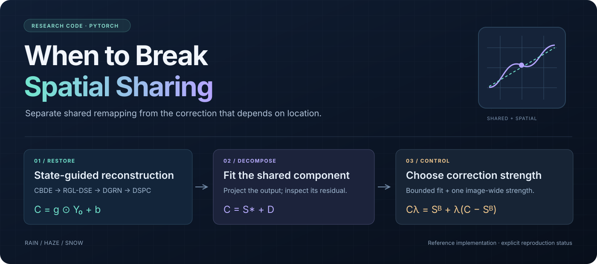

<div align="center">



### 统一恶劣天气图像恢复的输出空间分解

[](https://github.com/Nopon-Knowledge/spatial-sharing-restoration/actions)
[](pyproject.toml)
[](LICENSE)

**[English](README.md) · [简体中文](README.zh-CN.md)**

</div>

## 这份代码研究什么

空间变化的校正能带来多少独立价值？这份代码将恢复输出拆成全图共享变换与剩余校正，再通过空间平移、误差分解和强度预测检验剩余校正的作用。

对应当前主稿 **When to Break Spatial Sharing: Output-Space Decomposition for Unified Adverse Weather Restoration**，依据 `main.tex` 引用的现行方法章节及补充材料实现。这个目录可以单独复制、安装和使用，不依赖上级目录的 Python 文件。

这是根据论文新写的参考实现，**不是从原实验服务器恢复的历史代码，也不包含已训练权重、WeatherBench 图像或原始划分清单**。本地验证覆盖数学性质、模块梯度和合成数据完整流程；正式 AirNet/CUDA 训练与论文结果复现尚未执行。

## 包含什么

| 内容 | 代码 |
| --- | --- |
| RGL-DSE、残差监督、DSPC、24 维强度预测器 | `spatial_sharing/modules.py` |
| AirNet CBDE/DGRN 接口、B0–B5、共享头与模块对照 | `spatial_sharing/model.py` |
| 场景清单、配对增强、等预算三任务抽样 | `spatial_sharing/data.py` |
| 两阶段训练、验证选模、断点续训、推理 | `spatial_sharing/engine.py` |
| 仿射 LS、Box-LS、oracle 强度 | `spatial_sharing/projection.py` |
| 颜色矩阵、单调共享曲线、平移/重投影、成对 bootstrap | `spatial_sharing/analysis.py` |
| 冻结主干缓存、门控训练及验证集固定强度选择 | `spatial_sharing/gate_training.py` |
| Y/RGB PSNR、SSIM、ΔE76、越界率、可选 LPIPS | `spatial_sharing/metrics.py` |
| 公式、参数量、梯度、数据边界测试 | `tests/test_method.py` |

## 先检查代码能否运行

在本目录执行。建议 Python 3.10–3.12，并新建独立环境：

```bash
git clone https://github.com/Nopon-Knowledge/spatial-sharing-restoration.git
cd spatial-sharing-restoration
python3 -m venv .venv
source .venv/bin/activate
python -m pip install -e '.[test]'
python -m pytest -q
python -m spatial_sharing smoke --output runs/smoke
```

`smoke` 使用明确命名为 `SYNTHETIC_*` 的小图和专用小型测试骨干，在 CPU 上检查编码器训练、联合训练、断点续训一致性、图像评估、输出分解、门控缓存与训练、带门控推理。它不代表 AirNet，也不产生可填入论文的实验成绩。结果在 `runs/smoke/smoke_report.json`。

纯 CPU 检查不需要 AirNet。下载 AirNet 前，上游编码器接口测试会跳过；GitHub Actions 会获取固定版本并运行该测试。

默认正式配置始终是 `backend: airnet`。代码不会因缺少 CUDA 而自动替换骨干。

## 接入正式 AirNet

本实现调用 [AirNet 作者仓库](https://github.com/XLearning-SCU/2022-CVPR-AirNet) 的 `CBDE` 和 `DGRN`，使用其 `mmcv.ops.modulated_deform_conv2d`。公开仓库通过脚本获取上游固定版本：

```bash
python scripts/fetch_airnet.py
```

源码下载到被 Git 忽略的 `third_party/AirNet`，直接对应默认配置。固定提交为 `bedea82f7f7a71f135bcc026fd02ea9f2feaa710`，核对记录见 [docs/AIRNET_SOURCE.json](docs/AIRNET_SOURCE.json)。本地已存在该目录时无需重复下载；脚本不会覆盖已有文件。上游源码未随公开仓库再分发，许可边界见 [THIRD_PARTY.md](THIRD_PARTY.md)。

**CUDA 环境还必须安装与本机 PyTorch/CUDA 匹配、包含编译算子的 MMCV。** 上游原环境是旧版 PyTorch 1.7/mmcv-full 1.3.11，不能直接与本工程的现代 PyTorch 依赖混装；安装方式参照 [MMCV 官方文档](https://mmcv.readthedocs.io/en/latest/get_started/installation.html)，不要安装只有 Python 部分的 `mmcv-lite`。先检查：

```bash
python -c 'from mmcv.ops import modulated_deform_conv2d; print("MMCV operator import OK")'
CUDA_VISIBLE_DEVICES=0 python scripts/check_airnet.py --config configs/b2.yaml
```

第二条命令在真实骨干上检查两个阶段的前向/反向及推理。上游 MoCo 内部使用 `.cuda()`，本工程限定一个可见 GPU、`device: cuda:0`。没有替换其变形卷积、动量编码器或负样本队列。正式 CUDA 环境的兼容性以该检查实际通过为准。

## 准备数据清单

将 `configs/b2.yaml` 中的数据根目录与三个 CSV 清单改为真实路径。CSV 列为：

```csv
id,scene,task,input,target
rain_0001,scene_0001,rain,rain/input/0001.png,rain/target/0001.png
```

`task` 只能是 `rain/haze/snow`；图像路径相对于 `data.root`。`scene` 应是跨任务通用的真实场景标识，同一场景的视图、裁剪和天气版本必须在同一集合。训练前检查训练/验证/测试的 ID、场景和图像路径交叉。检查依赖提供的场景信息，不能发现错误命名掩盖的相同场景。

复现旧结果时应使用原始清单，程序不会按论文中的数量反造清单或猜测文件对应关系。训练图像必须与参考严格同尺寸且至少 128×128；不做隐式缩放。验证/测试统一从左上角裁到 16 的整数倍。左上角规则属于明确补全的实现约定。

## 训练与对照

```bash
CUDA_VISIBLE_DEVICES=0 python -m spatial_sharing train --config configs/b2.yaml --run runs/b2_s42
CUDA_VISIBLE_DEVICES=0 python -m spatial_sharing train --config configs/b2.yaml --run runs/b0_s42 --variant B0
CUDA_VISIBLE_DEVICES=0 python -m spatial_sharing train --config configs/b2.yaml --run runs/shared_s42 --variant shared
```

可选 `--variant`：`B0/B1/B2/B3/B4/B5/shared/airnet/dspc_only`。`B0` 对应有状态监督的 A4；`airnet` 去掉状态模块和 DSPC；`dspc_only` 只增加 DSPC。B1 仅偏移，B3/B4 使用直接 G 输入，B4/B5 增加粗尺度损失。`shared` 独立训练，每次前向平均实际增益 g 和偏移 b。

全局/局部消融可以修改 `global_enabled/local_enabled`；状态监督可选 `both/global/local/none`，错配监督设置 `mismatch: true`。这些开关保留已注册分支，因此消融的注册参数量不应当作删除分支后的参数量。

使用 `--seed 123` 等运行其他种子，保持同一数据清单。默认编码器 7,500 步、联合训练 54,375 步、batch 16、crop 128、三任务等额抽样。每阶段样本数分别为 120,000 和 870,000。联合阶段按验证集三任务宏平均 Y-PSNR 选择 `best.pt`；编码器阶段保留最后状态，不用尚未训练的 DGRN 评分选模。

```bash
python -m spatial_sharing train --config configs/b2.yaml --run runs/b2_s42 --resume runs/b2_s42/last.pt
```

如原运行使用了 `--variant/--seed`，续训时传入相同参数。记录包括优化器、更新位置、模型/队列、随机数状态、实际配置、源码哈希、环境版本、清单哈希及逐步损失。已有运行目录默认不覆盖。实现为单 GPU FP32；不含 DDP、AMP 或分块推理。

## 评估和输出分解

```bash
python -m spatial_sharing evaluate --checkpoint runs/b2_s42/best.pt --manifest data/manifests/test.csv --root data/WeatherBench --output runs/b2_test
python -m spatial_sharing analyze runs/b2_test/000000.npz --output runs/b2_test/analysis_000000.json
python -m spatial_sharing infer path/to/image.png --checkpoint runs/b2_s42/best.pt --output runs/inference
```

评估逐图保存 `y0/gain/bias/corrected/target` 的**未裁剪** NPZ、显示 PNG 和 `metrics.json`。在 shell 中可将 `runs/b2_test/*.npz` 一次传给 `analyze`。拟合只使用 Y0 与 corrected，GT 仅参与诊断与质量评价。不要用 PNG 反算输出分解。LS 和 Box-LS 使用 float64；后者使用默认 `.4/.1` 参数界限。

单调曲线默认使用 `[0,1]` 上 17 个等距节点，越界 Y0 线性端点外推。论文未归档原节点规则；可通过 `--knots path/to/knots.json` 提供**预先由训练数据确定**的节点。不要把不同节点设置视为完全相同的实验。整图曲线拟合的内存随像素数增长，`--no-curve` 可跳过该项。

PSNR 先裁剪 RGB，再按论文的有限范围 BT.601 公式转换 Y；按图求 dB，再按任务平均，最后三任务等权宏平均。SSIM 固定 Gaussian 11×11、sigma 1.5、population covariance。LPIPS 可选：`pip install -e '.[perceptual]'` 后给评估加 `--lpips`，首次使用可能下载 AlexNet 权重。默认不声称已测 LPIPS。

## 门控训练

必须使用同一个冻结的 B2 `best.pt` 构造训练/验证缓存。训练缓存每任务最多取 2,000 个不同场景记录，实际少于该数量时按真实数量记录。

```bash
python -m spatial_sharing cache-gate --checkpoint runs/b2_s42/best.pt --manifest data/manifests/train.csv --root data/WeatherBench --split train --output runs/cache_train
python -m spatial_sharing cache-gate --checkpoint runs/b2_s42/best.pt --manifest data/manifests/val.csv --root data/WeatherBench --split val --output runs/cache_val
python -m spatial_sharing train-gate --train-cache runs/cache_train --val-cache runs/cache_val --config configs/gate.yaml --run runs/gate
python -m spatial_sharing train-gate --train-cache runs/cache_train --val-cache runs/cache_val --config configs/gate_mse.yaml --run runs/gate_mse
python -m spatial_sharing evaluate --checkpoint runs/b2_s42/best.pt --gate runs/gate/best.pt --manifest data/manifests/test.csv --root data/WeatherBench --output runs/gated_test
```

缓存损失为 `K - 2λT + λ²Q`，等价于整图未裁剪 RGB MSE。K/T/Q 和 GT 不进入预测器。标准化仅拟合训练特征，验证检查点按 Y-PSNR 选择，并同时导出验证集最佳固定强度。两种 gate 同容量、同初始种子、同目标，只改输入特征 dropout。使用错误的 B2 权重加载 gate 会被检查点哈希校验拒绝。

## 配对统计

```bash
python -m spatial_sharing bootstrap --records paired.json --first B2 --second B0 --output runs/bootstrap.json
```

`paired.json` 是记录列表，每项包含 `task`、`scene` 和 `scores`，例如 `{"task":"rain","scene":"s1","scores":{"B2":30.1,"B0":30.0}}`。应根据各模型实际逐图指标按 ID 对齐后构造。先场景内平均，再任务内成对重采样，默认 10,000 次。它评估固定检查点的场景不确定性，不替代五次真实训练。

实现边界、公式对应关系和补全细节见 [docs/IMPLEMENTATION.md](docs/IMPLEMENTATION.md)，本次实际验证见 [docs/VALIDATION.md](docs/VALIDATION.md)。


## 开源许可与贡献

本项目原创代码与文档采用 [MIT License](LICENSE)。AirNet 等第三方依赖、数据及权重遵循各自条款，未重新纳入本项目 MIT 授权。欢迎提交数值边界案例、复现记录和问题修复；开发流程见 [CONTRIBUTING.md](CONTRIBUTING.md)。
